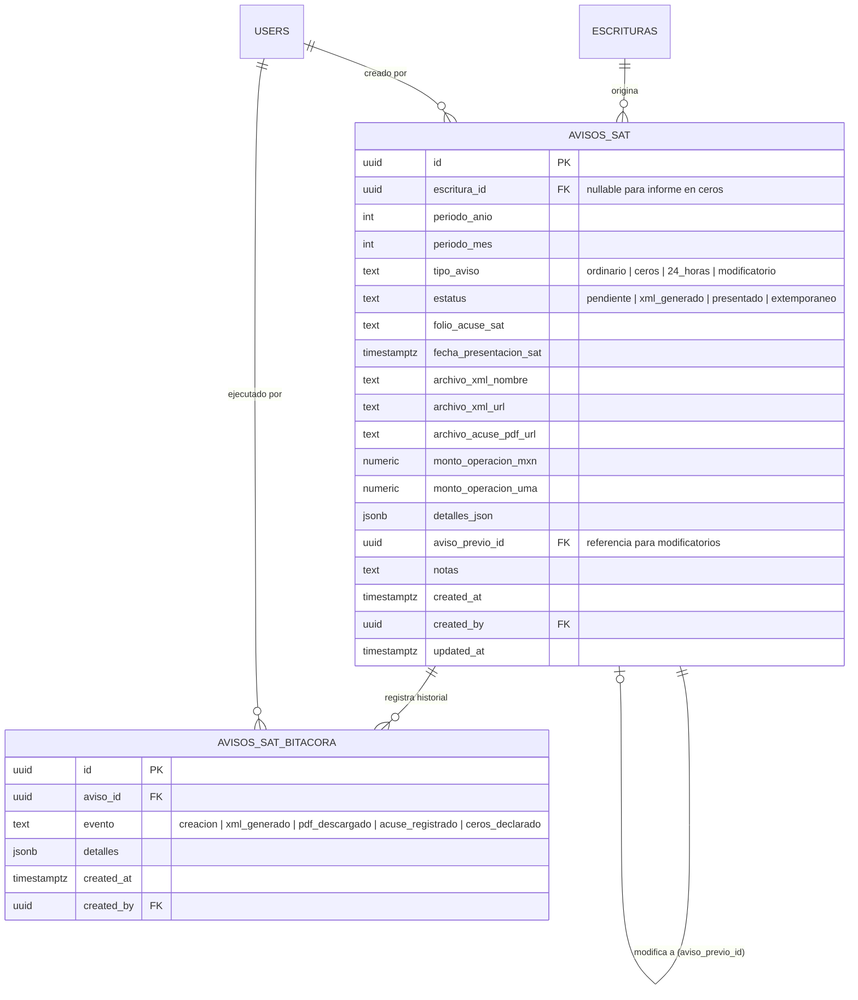

# Data Model: 11-avisos-sat (Avisos SAT / UIF - Prevención de Lavado de Dinero SPPLD)

**Feature**: `11-avisos-sat`  
**Date**: 2026-09-17  
**Status**: Ready

---

## 1. Diagrama Entidad-Relación



---

## 2. Definición de Tablas SQL

### 2.1 Tabla `avisos_sat`

```sql
CREATE TABLE public.avisos_sat (
    id UUID PRIMARY KEY DEFAULT gen_random_uuid(),
    escritura_id UUID REFERENCES public.escrituras(id) ON DELETE SET NULL,
    periodo_anio INTEGER NOT NULL CHECK (periodo_anio >= 2000),
    periodo_mes INTEGER NOT NULL CHECK (periodo_mes BETWEEN 1 AND 12),
    tipo_aviso TEXT NOT NULL CHECK (tipo_aviso IN ('ordinario', 'ceros', '24_horas', 'modificatorio')),
    estatus TEXT NOT NULL DEFAULT 'pendiente' CHECK (estatus IN ('pendiente', 'xml_generado', 'presentado', 'extemporaneo')),
    folio_acuse_sat TEXT,
    fecha_presentacion_sat TIMESTAMPTZ,
    archivo_xml_nombre TEXT,
    archivo_xml_url TEXT,
    archivo_acuse_pdf_url TEXT,
    monto_operacion_mxn NUMERIC(14,2) NOT NULL DEFAULT 0.00,
    monto_operacion_uma NUMERIC(12,2) NOT NULL DEFAULT 0.00,
    detalles_json JSONB NOT NULL DEFAULT '{}'::jsonb,
    aviso_previo_id UUID REFERENCES public.avisos_sat(id) ON DELETE SET NULL,
    notas TEXT,
    created_at TIMESTAMPTZ NOT NULL DEFAULT now(),
    created_by UUID REFERENCES auth.users(id),
    updated_at TIMESTAMPTZ NOT NULL DEFAULT now()
);

-- Índices de consulta rápida
CREATE INDEX idx_avisos_sat_escritura ON public.avisos_sat(escritura_id);
CREATE INDEX idx_avisos_sat_periodo ON public.avisos_sat(periodo_anio, periodo_mes);
CREATE INDEX idx_avisos_sat_estatus ON public.avisos_sat(estatus);
CREATE INDEX idx_avisos_sat_tipo ON public.avisos_sat(tipo_aviso);
```

### 2.2 Tabla `avisos_sat_bitacora` (Auditoría LFPIORPI de 10 años)

```sql
CREATE TABLE public.avisos_sat_bitacora (
    id UUID PRIMARY KEY DEFAULT gen_random_uuid(),
    aviso_id UUID NOT NULL REFERENCES public.avisos_sat(id) ON DELETE CASCADE,
    evento TEXT NOT NULL,
    detalles JSONB NOT NULL DEFAULT '{}'::jsonb,
    created_at TIMESTAMPTZ NOT NULL DEFAULT now(),
    created_by UUID REFERENCES auth.users(id)
);

CREATE INDEX idx_avisos_sat_bitacora_aviso ON public.avisos_sat_bitacora(aviso_id);
```

### 2.3 Vista `v_avisos_sat_mensual`

```sql
CREATE OR REPLACE VIEW public.v_avisos_sat_mensual AS
SELECT
    periodo_anio,
    periodo_mes,
    COUNT(id) AS total_avisos,
    COUNT(id) FILTER (WHERE tipo_aviso = 'ordinario') AS total_ordinarios,
    COUNT(id) FILTER (WHERE tipo_aviso = 'ceros') AS total_ceros,
    COUNT(id) FILTER (WHERE tipo_aviso = '24_horas') AS total_24h,
    COUNT(id) FILTER (WHERE estatus = 'presentado') AS total_presentados,
    COUNT(id) FILTER (WHERE estatus = 'pendiente' OR estatus = 'xml_generado') AS total_pendientes,
    COALESCE(SUM(monto_operacion_mxn), 0) AS monto_total_mxn
FROM public.avisos_sat
GROUP BY periodo_anio, periodo_mes;
```

---

## 3. Interfaces TypeScript

```typescript
export type TipoAvisoSat = 'ordinario' | 'ceros' | '24_horas' | 'modificatorio';
export type EstatusAvisoSat = 'pendiente' | 'xml_generado' | 'presentado' | 'extemporaneo';

export interface AvisoSatItem {
  id: string;
  escritura_id?: string | null;
  periodo_anio: number;
  periodo_mes: number;
  tipo_aviso: TipoAvisoSat;
  estatus: EstatusAvisoSat;
  folio_acuse_sat?: string | null;
  fecha_presentacion_sat?: string | null;
  archivo_xml_nombre?: string | null;
  archivo_xml_url?: string | null;
  archivo_acuse_pdf_url?: string | null;
  monto_operacion_mxn: number;
  monto_operacion_uma: number;
  detalles_json: Record<string, any>;
  aviso_previo_id?: string | null;
  notas?: string | null;
  created_at: string;
  created_by?: string | null;
  updated_at: string;
  
  // Relaciones hidratadas en UI
  numero_instrumento?: string;
  acto_juridico_nombre?: string;
  cliente_principal?: string;
}

export interface KpisAvisosSatPeriodo {
  periodo_anio: number;
  periodo_mes: number;
  total_operaciones_vulnerables: number;
  total_sujetas_aviso: number;
  total_presentados: number;
  total_pendientes: number;
  total_avisos_24h: number;
  monto_total_reportable_mxn: number;
  fecha_limite_base: string;
  dias_prorroga_rfc: number;
  fecha_limite_efectiva: string;
  dias_habiles_restantes: number;
  semaforo_urgencia: 'verde' | 'amarillo' | 'rojo';
  requiere_informe_ceros: boolean;
  informe_ceros_presentado: boolean;
}
```
