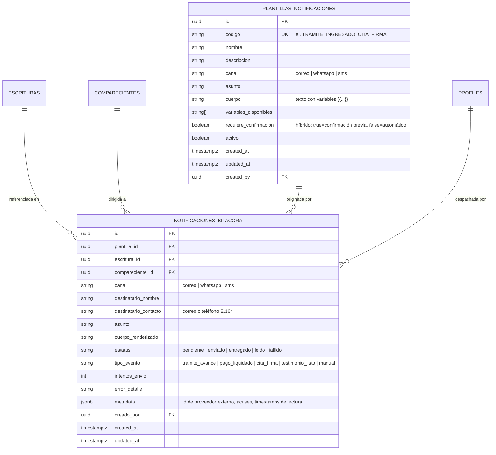

# Data Model: 12-notificaciones (Sistema Notarial de Notificaciones Multicanal y Avisos a Comparecientes)

## 1. Diagrama Entidad-Relación

---

## 2. Definición Detallada de Tablas

### 2.1 `public.plantillas_notificaciones`
Almacena el catálogo institucional de formatos y textos modelo para la comunicación de la notaría.

| Columna | Tipo | Nulo | Restricciones / Valor por Defecto | Descripción |
|---|---|---|---|---|
| `id` | `uuid` | No | `PRIMARY KEY DEFAULT gen_random_uuid()` | Identificador único. |
| `codigo` | `text` | No | `UNIQUE` | Clave programática única (ej. `CITA_FIRMA`, `TRAMITE_RPP`). |
| `nombre` | `text` | No | | Título descriptivo para la interfaz. |
| `descripcion` | `text` | Sí | | Explicación del propósito notarial del aviso. |
| `canal` | `text` | No | `CHECK (canal IN ('correo', 'whatsapp', 'sms'))` | Canal de transmisión preferente. |
| `asunto` | `text` | Sí | | Asunto del mensaje (requerido para correos). |
| `cuerpo` | `text` | No | | Contenido de la plantilla con tokens `{{variable}}`. |
| `variables_disponibles`| `text[]` | No | `DEFAULT '{}'` | Lista de variables interpolables soportadas. |
| `requiere_confirmacion`| `boolean`| No | `DEFAULT true` | Define si el evento requiere aprobación o es desatendido. |
| `activo` | `boolean`| No | `DEFAULT true` | Habilitación en la interfaz. |
| `created_at` | `timestamptz` | No | `DEFAULT now()` | Fecha de creación. |
| `updated_at` | `timestamptz` | No | `DEFAULT now()` | Fecha de última edición. |
| `created_by` | `uuid` | Sí | `REFERENCES auth.users(id)` | Usuario autor. |

### 2.2 `public.notificaciones_bitacora`
Registro histórico e inmutable de todos los avisos despachados o intentados por la notaría.

| Columna | Tipo | Nulo | Restricciones / Valor por Defecto | Descripción |
|---|---|---|---|---|
| `id` | `uuid` | No | `PRIMARY KEY DEFAULT gen_random_uuid()` | Identificador del envío. |
| `plantilla_id` | `uuid` | Sí | `REFERENCES plantillas_notificaciones(id)` | Plantilla base utilizada (si aplica). |
| `escritura_id` | `uuid` | Sí | `REFERENCES escrituras(id) ON DELETE SET NULL` | Instrumento notarial vinculado. |
| `compareciente_id`| `uuid` | Sí | `REFERENCES comparecientes(id) ON DELETE SET NULL` | Compareciente destinatario. |
| `canal` | `text` | No | `CHECK (canal IN ('correo', 'whatsapp', 'sms'))` | Canal utilizado. |
| `destinatario_nombre` | `text` | No | | Nombre del cliente/compareciente al momento del envío. |
| `destinatario_contacto`| `text` | No | | Correo electrónico o teléfono en formato E.164. |
| `asunto` | `text` | Sí | | Asunto final emitido. |
| `cuerpo_renderizado` | `text` | No | | Texto exacto despachado con variables resueltas. |
| `estatus` | `text` | No | `DEFAULT 'pendiente' CHECK (estatus IN ('pendiente', 'enviado', 'entregado', 'leido', 'fallido'))` | Estado de entrega. |
| `tipo_evento` | `text` | No | `DEFAULT 'manual'` | Hito notarial detonante. |
| `intentos_envio` | `int` | No | `DEFAULT 1` | Contador de reintentos. |
| `error_detalle` | `text` | Sí | | Explicación técnica ante falla o rebote. |
| `archivos_adjuntos` | `jsonb` | No | `DEFAULT '[]'::jsonb` | Lista de archivos adjuntos cargados (`nombre`, `url`, `tamano_bytes`, `tipo_mime`). |
| `metadata` | `jsonb` | No | `DEFAULT '{}'::jsonb` | Metadatos técnicos (Message ID, acuse, enlace a WhatsApp Web). |
| `creado_por` | `uuid` | Sí | `REFERENCES auth.users(id)` | Usuario o sistema emisor. |
| `created_at` | `timestamptz` | No | `DEFAULT now()` | Fecha y hora exacta del despacho. |
| `updated_at` | `timestamptz` | No | `DEFAULT now()` | Última actualización de estado. |

---

## 3. Índices de Rendimiento

- `idx_notificaciones_escritura_id` ON `notificaciones_bitacora(escritura_id)`
- `idx_notificaciones_compareciente_id` ON `notificaciones_bitacora(compareciente_id)`
- `idx_notificaciones_estatus` ON `notificaciones_bitacora(estatus)`
- `idx_notificaciones_created_at` ON `notificaciones_bitacora(created_at DESC)`
- `idx_notificaciones_canal` ON `notificaciones_bitacora(canal)`

---

## 4. Políticas de Seguridad (Row Level Security - RLS)

- `notificaciones_bitacora_select`: Lectura permitida a usuarios autenticados con permiso `notificaciones.ver`.
- `notificaciones_bitacora_insert`: Inserción permitida a usuarios autenticados con `notificaciones.reenviar` o mediante funciones del servidor / `service_role`.
- `notificaciones_bitacora_update`: Modificación de estatus restringida a `service_role` o usuarios con `notificaciones.reenviar`.
- `plantillas_notificaciones_select`: Lectura pública a cualquier usuario autenticado de la notaría.
- `plantillas_notificaciones_all_admin`: Inserción, actualización y borrado exclusivo para usuarios con `notificaciones.configurar_plantillas` o `administracion.acceso`.
