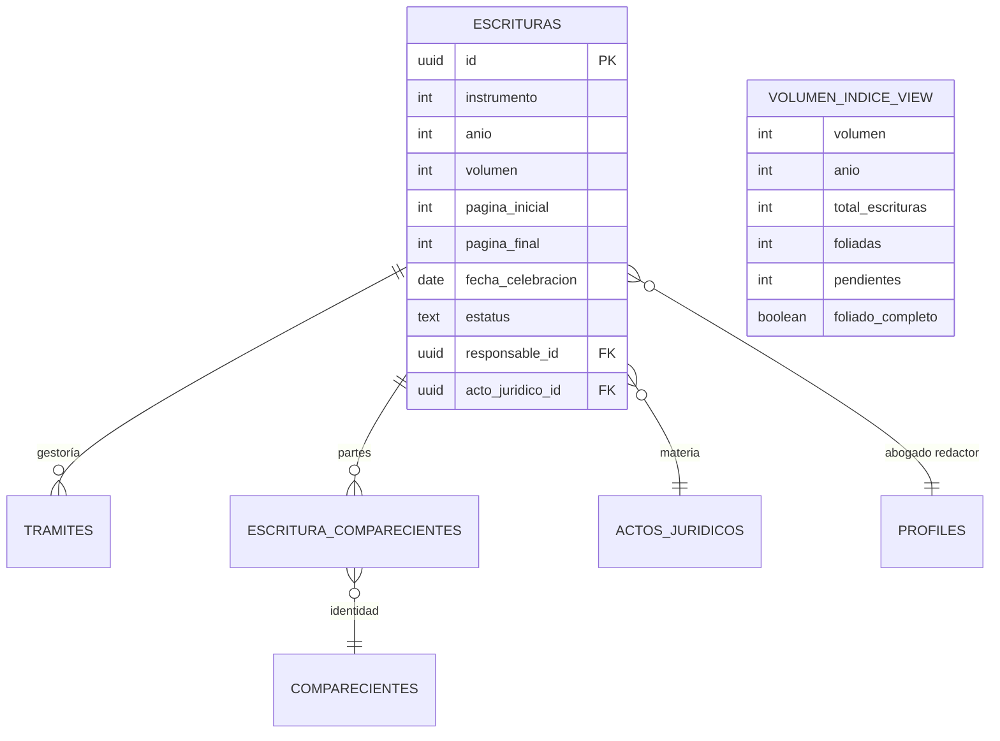

# Data Model: 13-reportes (Panel Ejecutivo, Reportes Operativos e Índices Notariales)

## 1. Esquema de Base de Datos y Entidades Existentes

El módulo de reportes opera principalmente como un motor analítico y agregador de lectura sobre las entidades del sistema, con una única operación de mutación de datos: la asignación de `pagina_inicial` y `pagina_final` en `public.escrituras`.

### Entidad Raíz: `public.escrituras`
Columnas empleadas para agregaciones e índices del protocolo:
```sql
-- Estructura ya existente en la base de datos (03-escrituras)
id uuid PRIMARY KEY,
instrumento integer NOT NULL,
anio integer NOT NULL,
volumen integer NOT NULL,
pagina_inicial integer NULL,
pagina_final integer NULL,
fecha_celebracion date NULL,
estatus text NOT NULL, -- 'borrador' | 'protocolizada' | 'anulada'
acto_juridico_id uuid NOT NULL REFERENCES public.actos_juridicos(id),
responsable_id uuid NULL REFERENCES public.profiles(id),
created_at timestamptz NOT NULL DEFAULT now()
```

### Relaciones Auxiliares de Lectura
- **`public.profiles`**: Redactor / abogado responsable (`id`, `nombre`, `email`).
- **`public.actos_juridicos`**: Catálogo de actos notariales (`id`, `nombre`, `tipo`).
- **`public.escritura_comparecientes`** + **`public.comparecientes`**: Partes otorgantes, adquirentes y comparecientes en general.
- **`public.tramites`**: Trámites de la escritura ante dependencias oficiales (`id`, `escritura_id`, `estatus`, `paso_actual`, `created_at`).
- **`public.honorarios_cuentas`** + **`public.honorarios_pagos`**: Saldos, cobranza y cuentas por cobrar (restringido a `reportes:ver_financieros`).

---

## 2. Contratos y Tipos TypeScript (`app/types/reportes.ts`)

```typescript
export interface ResumenKpisMes {
  total_abiertas_mes: number
  total_firmadas_mes: number
  total_en_tramite: number
  total_canceladas: number
}

export interface RedactorCargaItem {
  redactor_id: string
  nombre: string
  cantidad_escrituras: number
  porcentaje: number
}

export interface ActoDemandaItem {
  acto_id: string
  nombre: string
  cantidad: number
  porcentaje: number
}

export interface ReporteEscrituraGeneralItem {
  id: string
  instrumento: number
  anio: number
  volumen: number
  fecha_celebracion: string | null
  acto_nombre: string
  redactor_nombre: string
  estatus: 'borrador' | 'protocolizada' | 'anulada'
  tramites_asignados: number
  tramites_liberados: number
}

export interface VolumenIndiceCard {
  volumen: number
  anio: number
  total_escrituras: number
  instrumento_desde: number
  instrumento_hasta: number
  escrituras_foliadas: number
  escrituras_pendientes: number
  foliado_completo: boolean
}

export interface ComparecienteIndiceResumen {
  rol: string
  nombre: string
}

export interface EscrituraIndiceItem {
  id: string
  instrumento: number
  volumen: number
  fecha_celebracion: string | null
  acto_nombre: string
  comparecientes_resumen: ComparecienteIndiceResumen[]
  pagina_inicial: number | null
  pagina_final: number | null
  estatus: 'borrador' | 'protocolizada' | 'anulada'
}

export interface FiltrosReportesPeriodo {
  mes: number // 1 a 12
  anio: number
}

export interface ActualizarFoliadoPayload {
  escritura_id: string
  pagina_inicial: number | null
  pagina_final: number | null
}
```

---

## 3. Diagrama Entidad-Relación y Agregación


